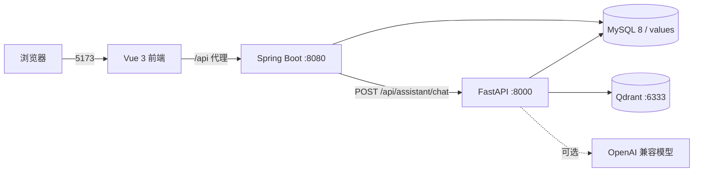

# 食物营养百科

一个面向 PC 端的食物营养查询与 AI 营养问答应用。前端使用 Vue 3 + Vite，Java 后端提供食物、分类与管理接口，Python 负责 USDA 数据导入、图片补全以及 AI 问答服务。

## 功能

- 首页浏览食物，支持分类筛选与关键词搜索
- 食物详情：每 100g 营养成分、NRV%、营养亮点、数据来源与判定标准
- AI 营养助手：多轮会话、历史记录、营养数据查询、知识检索与答案引用
- AI 回答带真实来源：营养库数值引用食物条数，知识回答引用知识文档标题与来源
- 管理端：食物管理、分类管理、图片审核
- 数据工具：USDA Foundation Foods 导入、食物图片补全与审核清单、营养知识索引
- AI 服务可选接入大模型；未配置 API Key 时直接基于营养库与知识库回答

## 技术栈

| 模块 | 技术 |
|---|---|
| 前端 | Vue 3、Vite 8、TypeScript、Pinia、Vue Router |
| 后端 | Java 17、Spring Boot 3.3、MyBatis-Plus、MySQL |
| AI 服务 | Python 3.12、FastAPI、Uvicorn、PyMySQL |
| 向量检索 | Qdrant（未启动时降级为进程内索引） |
| 数据来源 | USDA FoodData Central（Foundation Foods） |
| 营养判定 | GB 28050-2025（参考其营养声称判定口径） |

## 系统架构



- 前端只访问同源 `/api`，由 Vite 代理到 `http://localhost:8080`。
- Java 负责输入校验、会话归属校验、消息持久化，再把 AI 请求转发给 Python。
- Python 侧由 Agent 调度器决定走 SQL 营养查询、RAG 知识检索，或两者合并。
- 结构化营养数据始终走 SQL；向量库只保存知识文档切块，不复制营养数值。
- 未配置模型 Key 时，回答由代码基于数据库与检索结果确定性生成；配置 Key 后仍由答案审核器校验数值与引用。

## 目录结构

```text
values/
├── values-front/          Vue 3 前端
│   ├── src/
│   │   ├── views/         首页、食物详情、AI 助手、管理端页面
│   │   ├── components/    侧边栏、顶栏、食物卡片、分类筛选
│   │   ├── services/      食物、管理、AI 接口封装
│   │   └── stores/        Pinia 状态
│   └── public/foods/      食物图片静态资源
├── values-java/           Spring Boot 后端
│   └── src/main/
│       ├── java/           controller / service / repository / mapper
│       └── resources/
│           ├── db/         schema.sql、data.sql、migration/
│           └── mapper/     MyBatis XML
├── values-python/         Python 数据工具与 AI 服务
│   ├── food_nutrition/
│   │   ├── ingestion/     USDA 数据导入
│   │   ├── images/        图片补全与审核清单
│   │   └── ai/            FastAPI 服务
│   │       ├── rag/       切块、向量化、Qdrant 封装、检索、索引导入
│   │       ├── agents/    调度器、营养数据、知识、分析与答案审核
│   │       └── services/  统一问答与知识检索服务
│   ├── tests/             RAG、调度与审核的单元测试
│   └── data/images/       图片清单与审核产物
└── README.md
```

## 环境要求

- Node.js `^22.18.0 || >=24.12.0`
- JDK 17
- Maven 3.9+
- Python 3.11+（当前开发环境为 3.12）
- MySQL 8.0

## 快速开始

### 1. 初始化数据库

创建库表并写入字典与基础食物：

```sql
SOURCE c:/path/to/values-java/src/main/resources/db/schema.sql;
SOURCE c:/path/to/values-java/src/main/resources/db/data.sql;
SOURCE c:/path/to/values-java/src/main/resources/db/migration/V2__ai_conversation.sql;
```

说明：

- `schema.sql` 会自动创建 `values` 库（`utf8mb4`），并已包含 `ai_conversation`、`ai_message`。
- `data.sql` 只包含分类字典、来源字典和少量人工整理食物。
- 完整的 116 条食物与 1,647 条营养数据由 Python 导入脚本写入。
- 已有数据库只需执行一次 `V2__ai_conversation.sql`；该脚本只新增 AI 会话与消息表，不改动既有业务表。

导入 USDA 全量数据（可选，需要本机 USDA JSON 文件）：

```powershell
cd values-python
$env:USDA_JSON_PATH="C:\path\to\FoodData_Central_foundation_food_json.json"
python -m food_nutrition ingest --check
python -m food_nutrition ingest --apply
python -m food_nutrition ingest --verify
```

### 2. 启动 Java 后端

```powershell
cd values-java
mvn spring-boot:run
```

默认地址：`http://localhost:8080`

数据库连接在 `values-java/src/main/resources/application.properties` 中配置，也可以用环境变量覆盖：

```powershell
$env:SPRING_DATASOURCE_URL="jdbc:mysql://localhost:3306/values?useUnicode=true&characterEncoding=utf8&serverTimezone=Asia/Shanghai&useSSL=false&allowPublicKeyRetrieval=true"
$env:SPRING_DATASOURCE_USERNAME="root"
$env:SPRING_DATASOURCE_PASSWORD="your-password"
```

### 3. 启动 Python AI 服务

```powershell
cd values-python
python -m venv .venv
.\.venv\Scripts\Activate.ps1
pip install -r requirements.txt -r requirements-ai.txt
python -m food_nutrition ai-serve
```

默认地址：`http://127.0.0.1:8000`

健康检查：

```powershell
Invoke-RestMethod http://127.0.0.1:8000/health
```

不配置模型 Key 时，服务仍可启动，回答由代码基于营养库与知识库生成（`mode=database` / `mode=rag`）。

知识索引：

- 知识来源为 `nutrient_knowledge` 与 `values-python/data/knowledge/*.md`，结构化营养数值仍只走 SQL。
- 默认 embedding 为本地哈希向量，不依赖外部服务；也可配置 OpenAI 兼容的 `/embeddings` 接口。
- 推荐启动 Qdrant 后重建索引；Qdrant 或客户端不可用时自动降级为进程内索引，重启后需重新建索引。

```powershell
docker run -d -p 6333:6333 qdrant/qdrant
python -m food_nutrition rag-index --rebuild
python -m food_nutrition rag-search "蛋白质有什么作用？"
```

首次检索会自动建索引（`RAG_AUTO_INDEX=true`）。切换 embedding 模型或维度后必须执行 `--rebuild`，否则集合维度与查询向量不一致。

### 4. 启动前端

```powershell
cd values-front
npm install
npm run dev
```

默认地址：`http://localhost:5173`

页面入口：

- 首页：`/`
- 食物详情：`/foods/{id}`
- AI 营养助手：`/assistant`
- 管理端：`/admin/foods`

## AI 模型配置

复制 `values-python/.env.example` 为 `values-python/.env` 后填写即可，服务启动时会自动加载（`python-dotenv`）。进程环境变量优先级高于 `.env`，适合临时覆盖。

```ini
# 阿里云百炼（OpenAI 兼容模式）
AI_PROVIDER=dashscope
AI_MODEL=deepseek-v4.1-flash
AI_BASE_URL=https://dashscope.aliyuncs.com/compatible-mode/v1
AI_API_KEY_ENV=DASHSCOPE_API_KEY
DASHSCOPE_API_KEY=sk-...
```

其他供应商：

```powershell
# OpenAI
$env:AI_PROVIDER="openai"; $env:OPENAI_API_KEY="sk-..."

# DeepSeek 官方
$env:AI_PROVIDER="deepseek"; $env:DEEPSEEK_API_KEY="sk-..."
```

未配置 Key 时服务照常启动，回答自动降级为基于营养库与知识库的确定性回复。

常用可选变量：

| 变量 | 说明 | 默认值 |
|---|---|---|
| `AI_MODEL` | 模型名称 | 按供应商决定 |
| `AI_TEMPERATURE` | 生成温度 | `0.2` |
| `AI_BASE_URL` | OpenAI 兼容接口地址 | 按供应商决定 |
| `AI_SERVICE_HOST` | FastAPI 监听地址 | `127.0.0.1` |
| `AI_SERVICE_PORT` | FastAPI 监听端口 | `8000` |

RAG 与向量检索变量：

| 变量 | 说明 | 默认值 |
|---|---|---|
| `QDRANT_ENABLED` | 是否尝试连接 Qdrant | `true` |
| `QDRANT_URL` | Qdrant 地址 | `http://127.0.0.1:6333` |
| `QDRANT_COLLECTION` | 集合名称 | `nutrition_knowledge` |
| `EMBEDDING_PROVIDER` | `hash`（离线）或 `openai` | `hash` |
| `EMBEDDING_MODEL` | 嵌入模型 | `hash-ngram-v1` |
| `EMBEDDING_DIM` | 向量维度，必须与集合一致 | `384`（openai 默认 `1536`） |
| `RAG_TOP_K` | 召回条数 | `4` |
| `RAG_MIN_SCORE` | 最低相似度 | `0.2` |
| `RAG_AUTO_INDEX` | 首次检索自动建索引 | `true` |
| `KNOWLEDGE_DIR` | 额外 Markdown 知识目录 | `values-python/data/knowledge` |
| `RAG_INCLUDE_PENDING` | 是否召回未审核知识 | `false` |

回答模式：

| mode | 含义 |
|---|---|
| `llm` | 使用大模型生成，回答需通过答案审核 |
| `database` | 直接基于营养库数据生成 |
| `rag` | 基于知识库检索结果生成 |
| `placeholder` | AI 服务不可用时的降级回复 |

## 主要接口

| 方法 | 路径 | 说明 |
|---|---|---|
| `GET` | `/api/categories` | 分类列表 |
| `GET` | `/api/foods` | 食物列表 |
| `GET` | `/api/foods/{id}` | 食物详情、营养卡片、亮点与来源 |
| `POST` | `/api/assistant/chat` | AI 营养问答（兼容旧请求，可带 `conversationId`） |
| `GET` | `/api/assistant/conversations` | 当前用户的会话列表（分页） |
| `POST` | `/api/assistant/conversations` | 新建空会话 |
| `DELETE` | `/api/assistant/conversations/{id}` | 删除会话及其消息 |
| `GET` | `/api/assistant/conversations/{id}/messages` | 会话消息（分页） |
| `GET` | `/api/admin/categories` | 管理端分类列表 |
| `POST` | `/api/admin/categories` | 新增分类 |
| `PUT` | `/api/admin/categories/{id}` | 更新分类 |
| `DELETE` | `/api/admin/categories/{id}` | 删除分类 |
| `GET` | `/api/admin/foods` | 管理端食物分页查询 |
| `POST` | `/api/admin/foods` | 新增食物 |
| `GET` | `/api/admin/foods/{id}` | 管理端食物详情 |
| `PUT` | `/api/admin/foods/{id}` | 更新食物 |
| `DELETE` | `/api/admin/foods/{id}` | 删除食物 |
| `GET` | `/api/admin/images` | 图片审核清单 |
| `PATCH` | `/api/admin/images/{foodId}/review` | 更新图片审核状态 |

AI 对话请求：

```json
{
  "message": "西兰花有哪些营养亮点？",
  "conversationId": 12,
  "history": [
    { "role": "user", "content": "上一轮问题" },
    { "role": "assistant", "content": "上一轮回答" }
  ]
}
```

- `conversationId` 可省略：旧客户端行为保持不变，后端自动创建会话并在响应中返回新 ID。
- 带上 `conversationId` 即连续对话；服务端优先使用数据库中的历史，`history` 仅在会话暂无消息时兜底。
- 会话归属通过 `X-User-Id` 请求头校验；前端会在 localStorage 生成并持久化匿名 UUID。
- 访问他人的会话返回 `403`，会话不存在返回 `404`。

AI 对话响应：

```json
{
  "reply": "西兰花每 100g 含……",
  "mode": "database",
  "suggestions": ["高蛋白的食物有哪些？"],
  "citations": [
    {
      "documentId": "food:1",
      "title": "西兰花的营养成分",
      "source": "USDA SR Legacy",
      "url": "",
      "snippet": "每 100g 维生素 C 含量……",
      "score": 1.0,
      "kind": "food",
      "reviewStatus": "approved",
      "version": "1"
    }
  ],
  "conversationId": 12,
  "assistantMessageId": 34,
  "intent": "food_detail"
}
```

回答没有足够证据时，`citations` 为空且正文会明确说明「知识库中没有找到足够依据」，不会补造数值。

## 数据模型

核心表：

| 表 | 作用 |
|---|---|
| `food` | 食物基础信息、分类、图片、来源与核验状态 |
| `food_nutrient` | 每种食物每 100g 的营养素含量 |
| `nutrient_info` | 35 项营养素的单位、NRV 与富含判定规则 |
| `nutrient_knowledge` | 营养素生理作用与科普来源 |
| `food_category` | 食物分类字典 |
| `data_source` | 数据来源字典 |
| `rule_source` | 营养声称判定标准 |
| `ai_conversation` | AI 会话：用户、标题、创建与更新时间 |
| `ai_message` | AI 消息：角色、正文、引用 JSON、回答模式与状态 |

AI 会话表由 [V2__ai_conversation.sql](values-java/src/main/resources/db/migration/V2__ai_conversation.sql) 创建，`ai_message` 通过外键级联删除。

两个视图：

| 视图 | 作用 |
|---|---|
| `v_food_nutrient_nrv` | 计算每种食物的营养素 NRV% |
| `v_food_highlight` | 筛选达到富含标准且带科普内容的营养素 |

关键口径：

- 营养数值统一按每 100g 可食部分存储。
- `nrv_percent` 由视图计算，不在业务表中重复保存。
- 富含判定支持 `NRV_PERCENT` 与 `ABSOLUTE` 两种规则。
- 库中没有记录的营养素应回答“未收录”，不能推断为 0。

## 常用命令

```powershell
# 前端类型检查与构建
cd values-front
npm run type-check
npm run build

# 后端编译与测试
cd values-java
mvn -q -DskipTests compile
mvn test

# Python 服务与测试
cd values-python
python -m food_nutrition ai-serve
python -m food_nutrition rag-index --rebuild
python -m food_nutrition rag-search "蛋白质有什么作用？"
python -m unittest discover -s tests -t .
python -m food_nutrition images-check
```

## 安全与限制

- 当前为本地原型，管理端接口**没有登录与权限校验**，不要直接暴露到公网。
- Java CORS 白名单只允许 `http://localhost:5173` 与 `http://127.0.0.1:5173`；换端口需要同步修改 `WebConfig`。
- AI 回答只用于营养知识参考，不构成医疗或个体化膳食建议。
- 食物库当前为小样本数据，排名类结论仅代表库中已录入的食物。